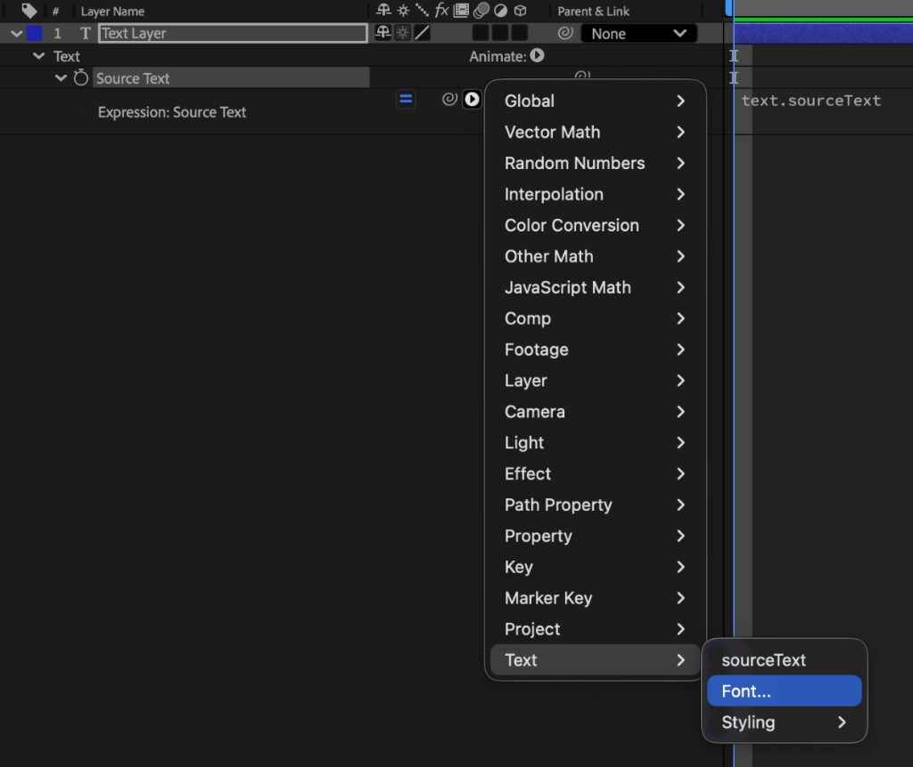

---
title: Best practices for Dynamic Graphics Render
description: Best practices and frequently asked questions for motion designers authoring After Effects Projects and Motion Graphics Templates for the Dynamic Graphics Render API.
keywords:
  - Dynamic Graphics Render
  - DGR
  - MOGRT
  - After Effects
  - Motion Graphics Templates
  - Essential Graphics
  - best practices
contributors:
  - https://github.com/Rob-Barrett
  - https://github.com/aeabreu-hub
  - https://github.com/sandeepy-gh
  - https://github.com/schhatwalgitacc
---

# Best practices for Dynamic Graphics Render and MOGRTs

Explore best practices and find answers to frequently asked questions about Firefly Services Dynamic Graphics Render API for Adobe After Effects Projects and Motion Graphics Templates.

## Who is this guide for?

This document is intended to help guide motion designers working in Adobe After Effects to create optimized Motion Graphic Templates (MOGRT) or After Effects Projects (AEP) that are compatible with the Dynamic Graphics Render (DGR) API.

## What is Dynamic Graphics Render?

Dynamic Graphics Render (DGR) is an infinitely scalable service that renders data-driven After Effects templates using [Motion Graphics Templates](https://helpx.adobe.com/after-effects/using/creating-motion-graphics-templates.html) (MOGRT) and After Effects Projects (AEP). The service reduces repetitive tasks required to produce and render video variations through automation and integrations in production and marketing supply chains.

Driven by a structured data set that represents the changeable parameters defined in After Effects (like CSV or JSON), the service concurrently renders each video and returns the output to your designated cloud location (for example, Frame.io or a signed URL location).

### What can DGR be used for?

DGR can be used to render any MOGRT or AEP at scale. Typical use cases include:

Rendering videos that are optimized for various:

- target audiences,
- consumption devices, and
- social platforms.

Rendering a high volume of:

- video with different text,
- images, and
- video and audio for advertising and performance marketing.

### When to use DGR with an AEP workflow

In most cases, using DGR with an AEP workflow is the preferred method.

* Additional capabilities such as layer operations, advanced audio replacement, and the Advanced 3D and Cinema 4D renderers are available.
* If your templates need to dynamically adapt to the duration of replacement assets, the AEP workflow is required.
* You would like to render multiple comps from the same template (in separated API calls). For example, this allows you to have different versions of a template (eg. 9:16, 16:9) in a single source file, and you can choose which comp to render.
* You require a modified `.aep` project from DGR, in order to carry out 'last mile' adjustments. This project file contains all data and layer operation changes.
* If changes to the template are required after collecting, you can open the collected `.aep` file and make changes directly. This can make it easier to work on templates as part of a team.
* If you require the burned-in captions features of DGR, this is currently only available through an AEP workflow.

### When to use DGR with a MOGRT workflow

* If your project contains a single main composition that should be rendered, or you would like to explicitly separate compositions into different template files (eg. for 9:16, 16:9, etc.).
* If your composition and its layers will not need to change their duration or timing.
* If your template already exists as a MOGRT, you may not need to make any (or many) changes in order to use it with DGR.
* If you would like to ensure that certain advanced capabilities, such as layer operations, are not made available to the end user.
* If you would like to discourage editing of templates after their creation.
* If you would like to packing a specific After Effects composition and its associated assets into a single, easily distributable file.

**Note:** MOGRT files can be opened in After Effects by renaming their file extension to `.zip` and expanding to a `.aeproject` file. You can then rename the file extension of this to `.zip` and expand a second time to get a `.aep` file with it's associated footage.

### Core capabilities of DGR

DGR capabilities include (but are not limited to) text replacement, image and video replacement, and audio replacement (which is a feature not available in standard MOGRT workflows).

When using DGR with an After Effects Project, capabilities additionally include (but are not limited to) dynamic layer operations (retiming comps and layers, and enabling/disabling layers), SRT-driven, burned-in captions. Image, video and audio replacement takes place within the comp, allowing functionality such as re-positioning layers based on a replacement media source's width (which is not possible in standard MOGRT workflows).

Motion designers can design templates in After Effects and export them as `.mogrt` files, or collect projects and compress to a `.zip` file, which contains the project's `.aep` file and all associated assets. The DGR API is able to recognize the exposed Essential Properties controls for data insertion. By providing a dataset to populate these controls, users can generate hundreds or thousands of video variations without manually updating the template in After Effects or Premiere.

End users don't need to have After Effects or Premiere experience. If a user can fill out a spreadsheet or complete an online form, they're able to generate videos with Dynamic Graphics Render.

## Tips for preparing a DGR-ready After Effects project (MOGRT and AEP types)

These tips will help you prepare your templates to be DGR-ready.

**Create separate templates for different aspect ratios and durations:**

When creating videos for multiple aspect ratios (for example, 9:16 portrait; 16:9 landscape), a separate MOGRT or comp should be created for each.

**Give properties unique names in the Essential Graphics panel:**

To avoid any potential conflicts in the API, it's recommended to ensure that all properties (controls) in the Essential Graphics panel have unique names, even if you're separating similar controls into groups.

For example, if you have a "Text" property in both an "Intro" and an "Outro" group, consider naming the properties "Intro Text" and "Outro Text".

**Pre-render where possible:**

It can often be beneficial to pre-render the parts of your composition that won't change, or that won't interact with any customizable elements. This reduces the processing requirements when rendering, for a faster output.

This can also be helpful when your template contains effect-heavy layers that render slowly. You can check for these layers by enabling the Render Time column. To enable this, right-click in the header row of the Timeline panel and select Columns > Render Time, or click the snail icon in the bottom-left of the Timeline panel.

**Avoid third-party effects and plug-ins:**

It's not currently possible to install third-party effects or plug-ins. Please avoid using these in your templates. If third-party effects or plug-ins are used, your DGR exports may fail, or may not render as expected.

If third-party effects are unavoidable, consider if you are able to pre-render those layers before exporting the template.

**Include safeguards for safe areas:**

If designing for formats that recommend keeping elements within safe areas (for example, to avoid cut-off in TV broadcasts, or to avoid elements being placed underneath the UI in apps like Instagram or TikTok), be aware that dynamic content might extend beyond the planned area. This is most likely with Text layers set to Point text.

It can be helpful to add expressions to limit or adjust the size or position of your layers to automatically keep them within the safe areas, for example, by [using copyfit expressions](#copyfit-text-fitting) to scale down a text layer if its content exceeds a specified width.

Recommended safe area guidelines can generally be found on the platform's website or provided by your team's contact at the relevant organization.

## Tips for preparing a DGR-ready After Effects project (MOGRT type)

**Design templates for a fixed duration:**

In Adobe Premiere Pro, MOGRTs can be created with protected regions, allowing a user to adjust the duration of the template.

These adjustable duration compositions are **not** currently supported by DGR when using a MOGRT as the input. Videos rendered with DGR are always the same duration as the composition from which the MOGRT was created.

If templates of different durations are required, these should be created as separate MOGRTs.

*(Variable duration videos and layers are supported by DGR when using an AEP as the input.)*

**Real-time feedback is not available via DGR when using a MOGRT as the input – plan your MOGRT controls accordingly:**

When using MOGRTs in Adobe Premiere Pro, users can see the template update in real time when control values are changed. As the DGR API runs as a headless service, this real-time feedback is not available. Plan your controls with this limitation in mind.

For example, rather than using a Slider control to adjust the position of a layer, consider using a Dropdown Menu control to limit the position to a few pre-defined options.

Be sure to test the template for edge cases within After Effects before exporting the MOGRT.

*(Real-time feedback is supported by the DGR Panel extension, when using DGR with an AEP as the input.)*

**Use the Classic 3D renderer:**

If your template includes 3D layers, ensure all relevant compositions are using the Classic 3D renderer. The Advanced 3D and Cinema 4D renderers are not supported by DGR when using a MOGRT as the input.

In Adobe After Effects, you can change the renderer in the 3D Renderer tab in the Composition Settings dialog box.

*(All 3D renderers are supported by DGR when using an AEP as the input).*

## Tips for preparing a DGR-ready After Effects project (AEP type)

**Audio replacement requires audio-only layers**

Only audio-only layers are described for audio replacement. You can tell if a layer is audio-only when the eyeball icon is missing but the audio icon is present.

To replace audio in layers that also contain graphics, expose these layers as replacment media controls in the Essential Graphics panel.

**Real-time feedback with DGR Panel**

You can install the [DGR Panel extension](https://exchange.adobe.com/apps/cc/205794/dgr-panel) from Adobe Exchange to add a panel to After Effects which allows you to test dynamic changes to your templates in real-time.

Instead of guessing how a render batch will turn out, you can see exactly how replacement data resolves in your template, how layer operations reshape your composition, generate the matching render payload, and run test renders against the DGR API — all without leaving After Effects.

This allows the designer to confidently test for edge cases with real and sample data, build an array of layer operations, and send test renders to the DGR API.

## Optimize template file size

Larger file sizes (for both `.mogrt` and collected `.zip` files) can increasing render times. These tips can help you optimize for performance.

**Exclude video preview (MOGRT workflow only):**

When exporting a MOGRT from the Essential Graphics panel, the 'Include video preview' option gives you the choice to embed a video preview in the `.mogrt` file. This is used in Premiere and other software to preview the template; for instance, in Premiere's Graphics Templates panel.

This preview is not used by DGR, so disabling this option before exporting can significantly reduce the file size.

**Optimize non-replaceable media assets:**

If your template uses media assets such as video, image or audio files that are not replaceable, you may be able to optimise these. Consider the following examples:

Scale or crop:
If a video or image is only ever displayed at 50% scale, you could scale the original file to 50% and set the scale in After Effects to 100%. Similarly, if only the top half of a video or image is ever displayed, you might wish to crop the original file to that region.

Duration:
If a video or audio layer only uses a section of the asset's full duration, you could trim the original file to just that section, and reimport to After Effects. Replace and align the original layer(s) to match.

File format:
Uncompressed formats, such as `.mov`, `.tiff` or `.wav`, generally have larger file sizes. You can experiment with re-encoding these to compressed formats, such as `.mp4`, `.jpg` or `.mp3`. It's important to note that After Effects will generally process uncompressed formats faster, but smaller file sizes may lead to overall faster job completion in DGR.

Alpha:
If a video requires an alpha channel (usually requiring a larger `.mov` file), an alternative may be to render a non-alpha version alongside a luma matte, and use the luma matte to reintroduce the alpha channel.

**Optimize media replacement assets:**

You might find that you're including large assets that will always be replaced as part of the DGR job. In this case, you can swap these out for placeholder assets.

For both video and image layers, you can use an image placeholder (an image control can always receive a video asset, and vice versa). To do this, open the Essential Graphics panel and right-click the video or image control to select the 'Replace Layer with Placeholder' option. This will create a new image file in your Project panel, and replace the layer's source with this.

Alternatively, you can create your own placeholder image at an appropriate size and replace the original asset with this. Import the placeholder, select your assets in the Project or Timeline panel, and – while holding Alt (Windows) or Option (Mac) – drag the placeholder asset from the Project panel onto these.

For audio layers, you can replace the asset with a short, silent audio clip. You can download a suitable placeholder clip here. To do this, either right-click each asset in your Project panel and Replace Footage with this placeholder audio file, or import the audio file and drag-replace using the technique described above.

@@@@@ Link to silent.wav @@@@@


## Video replacement

When assigning a layer as a Media Replacement property in the Essential Properties panel, be sure to set the Scale option to match the desired Scale to fill, Scale to fit, Stretch to fill, or No scale outcome. While you can override this scaling behaviour via DGR, this ensures that the default, fallback state is correct.

There is no limit on individual file size. However, the combined size of assets that can be replaced is capped at 5 GB.

- **Resolution:** Up to 3840 x 2160 pixels
- **Frame rate:** Up to 60 FPS

<InlineAlert variant="info" slots="heading, text" />

**Notes for MOGRT workflow:**
* If a replacement video is shorter than the duration of the layer that it is replacing, the last frame of the replacement video will be held until the end of the video layer's duration.
* Audio in replacement videos will be discarded. See 'Audio replacement' below for advice on changing audio.

## Image replacement

When assigning a layer as a Media Replacement property in the Essential Properties panel, be sure to set the Scale option to match the desired Scale to fill, Scale to fit, Stretch to fill, or No scale outcome. While you can override this scaling behaviour via DGR, this ensures that the default, fallback state is correct.

We support the file types described in the [API reference](../../api/index.md) and job responses when validation fails, with no limit on individual file size. However, the combined size of assets that can be replaced is capped at 5 GB.

- **Resolution:** Up to 3840 x 2160 pixels

## Audio replacement

There is no need to set this up in After Effects (the Essential Graphics panel currently doesn't support audio replacement).

We support the file types described in the [API reference](../../api/index.md) and job responses when validation fails, with no limit on individual file size. However, the combined size of assets that can be replaced is capped at 5 GB.

### Audio replacement in MOGRT workflow (Global Audio Replacement):

Currently, only one audio track is replaceable, with the following options:

- Replace: All existing audio is removed from the template, and the new audio file is inserted.
- Mix: Existing audio is retained, and the new audio is added to it.

Replacement audio tracks will always play from the start of the composition until the end of the composition, or until the end of the audio track (if the audio track has a shorter duration than the comp).

Audio processing features, like volume adjustment or ducking, are not available. If audio needs processing, like retiming to fit with the video timing, this should be done in an application like Adobe Audition before uploading to your media server, or the AEP workflow should be used.

### Audio replacement in AEP workflow:

All audio-only layers in your main comp are exposed as audio replacement layers. The source of these layers can be replaced or mixed:

- Replace: The layer's existing audio is replaced with the new audio file.
- Mix: Existing audio is retained, and the new audio is added as an additional layer, with the same in and out points.

Replacement audio files will inherit the trimming of the original layer. For example, if the first second of the audio is trimmed, this first second will still be trimmed after audio replacement. You can use layer operations to adjust the timing of the audio layer, if needed.

## Data files inside MOGRT or AEP

Data files (like CSV, TSV, or JSON files) can be included in After Effects projects to [drive animations or populate property values](https://helpx.adobe.com/after-effects/using/data-driven-animations.html). DGR supports MOGRTs that include and reference data files. It's recommended that any data files referenced in your project are added as a layer within a composition.

However, DGR does not currently support Media Replacement of data files.

## Font replacement

When calling the DGR API, fonts can be replaced by referring to a font's PostScript name. Any fonts used in the MOGRT should be delivered with the `.mogrt` file, as they will need to be supplied to the API service. Users are expected to have valid licenses for all fonts used.

Font replacement is also possible via expressions. References to fonts in expressions must match the font's PostScript name.

<InlineAlert variant="info" slots="heading, text" />

Tip

You can find a font's PostScript name in After Effects by opening the Expression language menu on any property and selecting **Text** > **Font…**. After you select a font and press **OK**, the PostScript name will be inserted into the expression.



## Text sizing

The native font size properties available to MOGRTs are not available to the Dynamic Graphics Render API.

Two alternatives exist:

- Font sizes can be defined in expressions (and controlled by an exposed Slider or Dropdown control).
- The Scale property of text layers can be adjusted by linking a Slider control to the layer's Scale property.

## Copyfit (Text fitting)

Copyfitting is not an inherent feature of DGR, MOGRTs, or After Effects.

Expressions can be added to layers to scale text to fit within specific boundaries, or to reposition based on the position or size of other layers in the comp.

You can find examples of copyfitting expressions and effect presets here.

**@@@@@ Add link to the expressions section below. @@@@@**

## How to pass blank text values

When passing data to the API directly (via a JSON call or similar), controls can be overwritten on a per-variation basis. By omitting a control for a particular variation, the control will fall back to its default value. Passing a string value of `""` will set a blank (empty) string for that text control.

However, when passing data via CSV or similar, where the data for multiple variations is defined within a single table, omitting a control on a per-variation basis is not possible. In this case, a blank value would make that control fall back to its default value. Currently, there is no way to denote that a table cell should set a blank (empty) string.

The following workarounds may help where this behaviour is required:

1. Provide a single space character (`" "`) as the value. In most cases, this will work without issue. However, take note that if any expressions rely on a character count, this may lead to unexpected results.
2. Before exporting the `.mogrt` or collecting the `.aep` file, set the control's value to a blank string in the Essential Graphics panel. This means that if a control falls back to its default value, it will be blank.

## Layer operations

When using DGR with an AEP workflow, you are able to apply various layer operations to layers, to adapt their timing and/or enabled status. This allows you to create dynamic templates not possible with traditional MOGRT workflows. Example include: 

* Extend/shorten comp duration based on replacement video duration: If you replace a video with one that is longer than the original, you can apply layer operations to extend the duration of this layer and its comp, and shift any subsequent layers accordingly.
* Maintain rendered video duration and fill gaps: If you replace a video with one that is shorter than the original, you can apply layer operations to shift and/or stretch existing layers to fill the gap.
* Maintain a single comp and use the `enable_layer` layer operation to turn on/off various layers to render stems.

A full list of layer operations and their descriptions can be found here:
https://developer.adobe.com/audio-video-firefly-services/guides/dgr/dgr-render#layer-operations-aep-only

It can be difficult to visualize how layer operations will affect a composition. We recommend using the [DGR Panel extension](https://exchange.adobe.com/apps/cc/205794/dgr-panel) from Adobe Exchange, which allows you to build a list of layer operations and test dynamic changes to your templates in real-time. This panel also allows you to view the render payload, which contains the generated layer operations payload.

## How to export a MOGRT for DGR (MOGRT workflow)

1. Open the Essential Graphics panel (this is where you will have been adding controls for the MOGRT).
    * You can find this under **Window** > **Essential Graphics**.
2. Click the **Export Motion Graphics Template…** button in the bottom-right corner.
3. Save your project when prompted to do so.
4. **Destination:** Choose a folder to save your `.mogrt` file to.
5. **Include video preview:** You can choose whether or not to embed a video preview in the `.mogrt` file. DGR currently doesn't make use of this, so it's recommendedto disable this option to significantly reduce the size of the MOGRT.
6. Click **OK**.

DGR is currently compatible with MOGRTs created in After Effects 2026 or earlier. If you have created your After Effects project in a later version:

1. Save to a version compatible with After Effects 2026 via **File** > **Save As…** > **Save a Copy As 26.x…**.
2. Then open that file in After Effects 2026 and export the MOGRT from the Essential Graphics panel.

It's recommended to disable the **Include video preview** option to significantly reduce the size of the `.mogrt` file.

## How to export a project for DGR (AEP workflow)

1. Collect your project by clicking the File menu and choosing **Dependencies** > **Collect Files…**
    * **Collect Source Files:**
        * Select **For All Comps** to include all comps from your project.
        * Select **For Selected Comps** if you'd like to only include specific comps (you will need to select those in the Project panel before collecting) . This option will also include any comps nested within the selected comps.
    * **Reduce Project:** Yes
2. Open the folder in which your project has been collected, and select all files and folders.
3. Compress these to a single `.zip` file. You can rename this file if needed.

**Important:** Your `.zip` file must include only one `.aep` file.

## Template guide and handover

After exporting your MOGRT or AEP templates, it can be helpful to provide an accompanying guide to help your team's engineers set up the API interaction correctly. This guide can include:

- The type and range of values that each control should expect.
- A relevant description of each control.
- **For AEP workflow:** The required layer operations. Ideally, you can provide the JSON payload generated with the DGR Panel extension. [link to the reference above]

It can also be helpful to specify the pixel dimensions and duration of the exported composition.

Also note that Dropdown Menu controls are 1-indexed both when referenced in expressions and by the DGR API (that is, the first option has a value of 1). Your accompanying guide should reflect this. For example, a Dropdown Menu control with three items could be listed as:

- `1`: Apple
- `2`: Banana
- `3`: Cherry

Any comments or groups in the Essential Graphics panel are currently not readable by the API, so don't rely on these as instructions to the end user.

### Suggested MOGRT package contents

- `.mogrt` file
- Font files
- Accompanying guide
- Sample media files for testing (if testing is required)

### Suggested AEP package contents

- `.zip` file containing:
    - `.aep` file (After Effects Project)
    - Project footage (assets) folder.
- Font files
- Accompanying guide
- Sample media files for testing (if testing is required)

## DGR export profiles

The output video render profiles that we support are:

- **Resolution:** Up to 3840 x 2160 pixels.
- **Frame rate:** Up to 60 FPS.

**Popular video codec support:**

- H.264, `.mp4` format
- ProRes (with alpha support), `.mov` and `.mxf` formats
- Apple ProRes 4444 XQ
- Apple ProRes 4444
- Apple ProRes 422 HQ
- Apple ProRes 422
- Apple ProRes 422 LT
- Apple ProRes 422 Proxy

**Popular audio codec support:** See encoder presets and your export requirements.

## DGR Encoder Presets

The following preset IDs are available through the [Presets API](index.md). For request and response examples, see [the sample request](index.md#sample-request) on the same page. Expand an item to see the encoder settings JSON for that preset.

<AccordionItem slots="heading, text, code" />

### `ffs_video_api_land_1080p_hq` — Landscape 1920×1080 – High Quality

Encoder settings:

```json
{
  "mediaType": "video/mp4",
  "codec": "H.264",
  "maxFps": {
    "numerator": 30,
    "denominator": 1
  },
  "bitrateMode": "vbr",
  "targetBitrateInKbps": 8000,
  "maxBitrateInKbps": 12000,
  "alpha": false
}
```

<AccordionItem slots="heading, text, code" />

### `ffs_video_api_land_1080p_lq` — Landscape 1920×1080 – Low Quality

Encoder settings:

```json
{
  "mediaType": "video/mp4",
  "codec": "H.264",
  "maxFps": {
    "numerator": 30,
    "denominator": 1
  },
  "bitrateMode": "vbr",
  "targetBitrateInKbps": 6000,
  "maxBitrateInKbps": 8000,
  "alpha": false
}
```

<AccordionItem slots="heading, text, code" />

### `ffs_video_api_square_1080p_hq` — Square 1080×1080 – High Quality

Encoder settings:

```json
{
  "mediaType": "video/mp4",
  "codec": "H.264",
  "maxFps": {
    "numerator": 30,
    "denominator": 1
  },
  "bitrateMode": "vbr",
  "targetBitrateInKbps": 6000,
  "maxBitrateInKbps": 8000,
  "alpha": false
}
```

<AccordionItem slots="heading, text, code" />

### `ffs_video_api_square_1080p_lq` — Square 1080×1080 – Low Quality

Encoder settings:

```json
{
  "mediaType": "video/mp4",
  "codec": "H.264",
  "maxFps": {
    "numerator": 30,
    "denominator": 1
  },
  "bitrateMode": "vbr",
  "targetBitrateInKbps": 3000,
  "maxBitrateInKbps": 4000,
  "alpha": false
}
```

<AccordionItem slots="heading, text, code" />

### `ffs_video_api_vert_1920p_hq` — Vertical 1080×1920 – High Quality

Encoder settings:

```json
{
  "mediaType": "video/mp4",
  "codec": "H.264",
  "profile": "high",
  "maxFps": {
    "numerator": 30,
    "denominator": 1
  },
  "bitrateMode": "vbr",
  "targetBitrateInKbps": 6000,
  "maxBitrateInKbps": 8000,
  "alpha": false
}
```

<AccordionItem slots="heading, text, code" />

### `ffs_video_api_vert_1920p_lq` — Vertical 1080×1920 – Low Quality

Encoder settings:

```json
{
  "mediaType": "video/mp4",
  "codec": "H.264",
  "profile": "high",
  "maxFps": {
    "numerator": 30,
    "denominator": 1
  },
  "bitrateMode": "vbr",
  "targetBitrateInKbps": 3000,
  "maxBitrateInKbps": 4000,
  "alpha": false
}
```

<AccordionItem slots="heading, text, code" />

### `ffs_video_api_prores` — ProRes export preset supporting alpha channel

Encoder settings:

```json
{
  "mediaType": "video/quicktime",
  "codec": "Apple ProRes 4444",
  "profile": "high",
  "maxFps": {
    "numerator": 30,
    "denominator": 1
  },
  "bitrateMode": "vbr",
  "alpha": true
}
```

We support [predefined social presets](index.md#sample-request) or a custom preset (or `.epr` files). `.epr` files are exported custom presets from Adobe Media Encoder.

## Support for expressions

Expressions are a fundamental part of layer properties and are respected in Dynamic Graphics Render. However, due to the vast range of possible expressions, there may be edge cases that are not supported.

The API supports an English environment. If you're designing in a non-English language version of After Effects, it's important to universalize expressions to avoid errors. When referencing other properties, you can use Matchnames or indices.

Alternatively, you can use third-party tools such as [ExpressionUniversalizer](https://aescripts.com/expressionuniversalizer/) to convert existing expressions to language-agnostic expressions.

DGR is currently compatible with `.mogrt` and `.aep` files created in After Effects 2026 or earlier. Avoid using any expressions that were added to After Effects after this version. You can [check the changelog for expressions](https://ae-expressions.docsforadobe.dev/introduction/changelog/).

<InlineAlert variant="info" slots="heading, text" />

Tip

When pickwhipping to reference an effect's property in your expression, hold the Alt/Option (Windows/macOS) key to reference the property by index, rather than by name.

Watch out for processing-heavy expressions like `sourceRectAtTime()`. When used without a time parameter, the results are calculated for every frame. When using a time parameter (for example, `sourceRectAtTime(0)`) the results are calculated for the defined frame only, which can improve performance.

## Support for Expression Control effects

The following Expression Control effects are currently supported by the DGR API:

- **Slider**
- **Dropdown Menu**
- **Checkbox**

### Slider

Value expected by the API: floating-point value, provided as a string.
Example: `"2.54"`

<InlineAlert variant="info" slots="heading, text" />

Note

The DGR API will limit (clamp) values for this control to the range that you specify within the Essential Graphics panel. Be sure to set a large enough range for any value you might expect a user to input.

### Dropdown Menu

Value expected by the API: array index provided as a string (1-index).
Example: `"1"`

<InlineAlert variant="info" slots="heading, text" />

Note

This control is 1-indexed within After Effects, matching the value expected by the API. The first option has an index of 1.

### Checkbox

Value expected by the API: `"true"` or `"false"`, provided as a string.

The following Expression Control effects are **not** currently supported by the DGR API:

- Angle
- Point
- 3D Point
- Color
- Layer

You can use one or more Slider effects in place of Angle, Point, and 3D Point, with appropriately defined ranges of values.

### Color

Add a text layer to your comp (hidden or set as a guide layer) and add its Text Source as an Essential Property. You can link Color properties to this Text Source property, using the following expression, to convert text-based Hex color values to RGBA color.

```javascript
const hexString = thisComp.layer("Color Value").text.sourceText.value;
hexToRgb(hexString);
```

### Layer

You can use a Slider effect in place of this, referring to layers by index.

Alternatively, you can use a Dropdown Menu effect. However, the menu must be manually populated; it will not auto-update when you rename, move, add, or delete layers.

## Expressions Guide

The following expressions may be helpful for creating flexible templates that adapt to dynamic content, for example, by copyfitting text to fit within specified bounds, or showing/hiding layers based on an expression control's value.

### What is copyfitting?

Copyfitting is the process of adjusting text to fit a specific amount of content into a pre-defined space. Examples of this might be ensuring that a text layer’s width doesn’t exceed that of the composition, or fitting multiple text layers to a multi-column layout.

You define the maximum height and/or width allowed for the text layer. If the content fits within that space, no scaling is applied; if the content’s size exceeds these dimensions, the layer is scaled down until it fits.

This ensures that dynamic content always automatically fits within the intended space in the template layout.

**@@@@@ Add copyfitting GIF image @@@@@**

### What is Paragraph Text and Point Text?

**Paragraph Text** (or Box Text) is text that has an area of pre-determined height and width into which text can flow. You can create this in After Effect by dragging an area in a composition with the Text tool.

Depending on the length of the copy, you should use this when including text that should wrap onto multiple lines.

**@@@@@ Add Paragraph Text image @@@@@**

**Point Text** is text that does not have a pre-defined area, but that instead is as wide as the text content, with text only moving onto additional lines when line- or paragraph-break characters are inserted (eg. by pressing Return). The height and width of the text layer are not limited. You can create this in After Effects by clicking in a composition with the Text tool.

You should use this for text that should be single-line (or (or for which you want to manually specify where line breaks should occur).

**@@@@@ Add Point Text image @@@@@**

### Expression: Center-align to the layer’s Position

To center your text layer horizontally and vertically to its Position value, apply the _‘Center Align to Layer Position.ffx’_ preset to the text layer.

Alternatively, you can apply the following expression to the text layer’s Anchor Point:

```javascript
const rect = sourceRectAtTime();
const x = rect.left + rect.width/2;
const y = rect.top + rect.height/2;
[x, y]
```

To only center horizontally, you can change Line 3 to read:

```javascript
const y = value[1];
```

To only center vertically, you can change Line 2 to read:

```javascript
const x = value[0];
```

### Script: Vertically align Paragraph text

Another option to vertically align Paragraph text is to use this script, which utilises scripting attributes added to After Effects v24.6 and later. With this, you can select a Paragraph text layer and select “Read from Selected Layer”, then select your desired alignment (top, center, bottom or justify) and click “Apply to Selected Text Layers”.

[https://github.com/AdobeDocs/after-effects/blob/main/samples/ComposeBoxTextOptions_ScriptUISample.jsx](https://github.com/AdobeDocs/after-effects/blob/main/samples/ComposeBoxTextOptions_ScriptUISample.jsx)

### Expression: Copyfitted text based on defined width and/or height

This expression will scale down your text layer if it exceeds a specified width or height. That width or height could be a value defined in your expression (or in a Slider control), or could be based on the width or height of another layer in your project.

Move the text layer’s Anchor Point to its vertical center (or align automatically using the above preset or expression), then apply the _‘Copyfit Text.ffx’_ preset to the text layer

Alternatively, you can apply this expression to your text layer’s Scale property:

```javascript
const widthMax = 500; // Maximum width in pixels
const heightMax = 200; // Maximum height in pixels
const widthCurrent = sourceRectAtTime().width;
const heightCurrent = sourceRectAtTime().height;
const widthScale = (widthCurrent > widthMax) ? (widthMax / widthCurrent) * 100 : value[0]; // Calculate width scaling, if text is wider than the maximum
const heightScale = (heightCurrent > heightMax) ? (heightMax / heightCurrent) * 100 : value[1]; // Calculate height scaling, if text is taller than the maximum
const newScale = Math.min(widthScale, heightScale); // Use the smallest of the widthScale and heightScale to set the scale
[newScale, newScale]
```

With either approach, you’re effectively defining a box within which the text should scale to fit.

**Note:** The text layer will scale around its Anchor Point. This may result in the position or alignment of your layer changing significantly (especially when applied to Paragraph text). Before applying the above expression, it’s recommended to reposition the layer’s Anchor Point to the point around which you’d like the layer to scale.

### Expression: Copyfitted text based on a guide layer

Rather than copyfitting text to a height and/or width that is hard-coded or driven by Slider values, you can also define the copyfit bounds by the height and/or width of another layer.

To do this, change the first two lines in the code above to the following, ensuring that the referenced layer name is correct:

```javascript
const guideLayer = thisComp.layer("Guide Layer");
const guideSize = guideLayer.sourceRectAtTime(time, false);
const guideScale = guideLayer.transform.scale;
const widthMax = guideSize.width * guideScale[0]/100; // Maximum width in pixels
const heightMax = guideSize.height * guideScale[1]/100; // Maximum height in pixels
```

Now, if the size or scale of the guide layer is adjusted, the copyfit bounds will match. This can make it easier to update without later needing to modify expressions.

Typical use cases of this are for any text sitting inside a resizable shape/pill/badge – for example, a date stamp, a price callout, a call-to-action – where the text’s width should track the guide instead of a hardcoded value.

**Note:** The `false` at the end of `sourceRectAtTime(time, false)` matters. A `false` value here measures the letters actually visible at the reference time (so it tracks the copy as it changes). A `true` value measures the size of the Paragraph text box itself, which stays the same no matter what the copy says – if your scale value looks ‘stuck’ and doesn't react when you change the text, this likely the cause. Swap in a shorter/longer word and confirm the behaviour before trusting it.

### Expression: Text Box automatically sized to a text layer

To create a box that matches the shape of a specified text layer, create an empty shape layer, and apply the _‘Autofit Text Box.ffx’_ preset to it. This will create a rectangle shape, with the required expressions. Ensure that you select the relevant layer on the ‘Text Layer’ property of the ‘Autofit Text Box’ effect. You can further customise the box after its creation (for example, by changing the color or applying additional effects or layer styles).

Alternatively, create a parametric rectangle with the Rectangle tool, match the Position of the shape layer to that of the text layer, and apply this expression to the rectangle’s Size property (making sure to update the textLayer reference to point to your text layer):

```javascript
const textLayer = thisComp.layer("Text Layer 1");
const textLayerSize = textLayer.sourceRectAtTime();
const textLayerScale = textLayer.transform.scale[0] / 100;
const padding = [20, 10];
const x = (textLayerSize.width * textLayerScale) + (padding[0] * 2);
const y = (textLayerSize.height * textLayerScale) + (padding[1] * 2);
[x,y]
```

### Expression: Show/hide layers based on a Slider or Dropdown value

If you would like to dynamically turn on/off layers – for example, you have a number of different layouts in your template, and you’d like to show a specific one based on the value selected for a Slider or Dropdown control – you can apply the following expression to each layer’s Opacity property, making sure to change the value after `==` for each layer.

```javascript
const sliderOrDropdownValue = thisComp.layer("Controls").effect("Slider/Dropdown Control")(1); // Connect this to your slider or dropdown control
(sliderOrDropdownValue == 1) ? 0 : value
```

If the Slider or Dropdown value is a match for a layer, the Opacity will be unaffected; if it doesn’t match, the Opacity will be set to zero.

You can use a layer’s index to make this adaptable to any number of layers. The following can be applied to all layers, without the need to manually change the layer number each time.

```javascript
const sliderOrDropdownValue = thisComp.layer("Controls").effect("Slider/Dropdown Control")(1); // Connect this to your slider or dropdown control  
(sliderOrDropdownValue == index) ? 0 : value
```

If your first layer isn’t at the top of the timeline layer stack, but you’d like this to be ‘on’ with a control value of 1, you can subtract from the index. The number that you subtract should be the number of layers that are above the first of these dynamic layers.

```javascript
(sliderOrDropdownValue == index – 1) ? 0 : value
```

**Note:** When showing/hiding a layer via expressions, make sure that the layer is enabled (the layer’s eye icon is visible). This enabled state can’t be affected by expressions – the Opacity property does the actual hiding.

### Expression: Show/hide layers based on a Checkbox value

This is the simpler sibling of the pattern above – use it when there are only ever two states (eg. show/hide, on/off), rather than several named options. A Checkbox control gives you a true/false switch instead of a numbered menu.

The following expression applied to a layer’s Opacity property will set the Opacity to 100% when the checkbox is true, and 0% when it is false.

```javascript
const checkboxValue = thisComp.layer("Controls").effect("Checkbox Control")(1); // Connect this to your checkbox control  
(checkboxValue == true) ? 100 : 0;
```

Typical use cases are for a simple on/off element, such as a ‘Show Badge?’ or ‘Show CTA?’ control.

**Note:** As above, when showing/hiding a layer via expressions, make sure that the layer is enabled (the layer’s eye icon is visible).

### Expression: Auto-fade audio at start and end of layer

When using DGR with an AEP template, you can replace audio and videos layers with sources of different durations, as well as apply layer operations to adjust layer timing. You can use expressions to read the start and end times of these layers and automatically adjust the volume of those layers to get a smooth fade-in and -out.

Select your layers and apply the _'Auto-Fade Audio.ffx'_ preset. This will add a number of Slider controls and a Stereo Mixer effect. Expressions applied to the Stereo Mixer effect will, beginning from a layer's start time, fade the audio up from minimum to maximum volume over a specified number of seconds. The audio will then fade down over a specified number of seconds at the end of the layer's duration. You can adjust the slider values to change these settings.

Alternatively, create four Slider expression controls and name them as follows:

* Fade In Duration (Seconds)
* Fade Out Duration (Seconds)
* Minimum Volume (%)
* Maximum Volume (%)

Add a 'Stereo Mixer' effect. On the 'Right Level' property, add the following expression. This links the Right Level to the Left Level, ensuring that the volume of both the left and right audio channels are adjusted by the same amount.

```javascript
effect("Stereo Mixer (Auto-Fade)")(1)
```

Then, on the 'Left Level' property, add the following expression. If the time is before the start of the layer plus the fade in duration, the audio will increase from min to max. Otherwise, it will decrease from max to min at the end of the layer.

```javascript
const fadeInDuration = effect("Fade In Duration (Seconds)")(1);
const fadeOutDuration = effect("Fade Out Duration (Seconds)")(1);
const volumeMin = effect("Minimum Volume (%)")(1);
const volumeMax = effect("Maximum Volume (%)")(1);
const layerStart = inPoint;
const layerEnd = (outPoint > layerStart + source.duration) ? layerStart + source.duration : outPoint;
// Fade In
if (time < layerStart + fadeInDuration) {
	ease(time, layerStart, layerStart + fadeInDuration, volumeMin, volumeMax)
}
// Fade Out
else {
	ease(time, layerEnd - fadeOutDuration, layerEnd, volumeMax, volumeMin)
}
```

### How to save and apply animation presets

Animation presets are a great way to save effect stacks and expressions to a user library, so that they can be applied to other layers at a later time. In addition to reducing duplication of effort, it also helps to cut down on user error, ensuring that effects and expressions are applied as expected.

To save an animation preset file, select one or more properties, effects or layer styles and/or the Effects or Layer Styles section of your layer(s). Go to 'Animation > Save Animation Preset…', choose your desired save location, then click 'Save'.

To apply an animation preset file (`.ffx`) to one or more layers, select those layers then go to 'Animation > Apply Animation Preset…', locate and select the file, and click 'OK'. If you have recently applied this preset, you may also select this from the 'Animation > Recent Animation Presets' list.

If you have saved your preset files to the User Presets folder for your version of After Effects, you may also be able to find and apply your presets from the 'Effects & Presets' panel.

### Referencing a sub-composition safely

If your project ever ends up with two comps that share the same name (easy to do by accident when duplicating a template comp), a direct reference to that comp in an expression – eg. `var logo = comp("Logo")` – becomes ambiguous. After Effects will always refer to the first comp it finds with that name, which may not be the one being used in your main comp.

The safer method references the pre-comp layer that’s actually placed in your timeline:

```javascript
var logo = thisComp.layer("Logo")
```

## See also

- [WKND Product Showcase sample MOGRT package](dgr-sample-mogrt-wknd.md)
- [Using the Presets API](index.md)
- [Using the Describe API](dgr-describe.md)
- [Using the Render API](dgr-render.md)
- [Authentication and setup](../../getting-started/index.md)
- [Technical usage notes](../../getting-started/usage/index.md)
